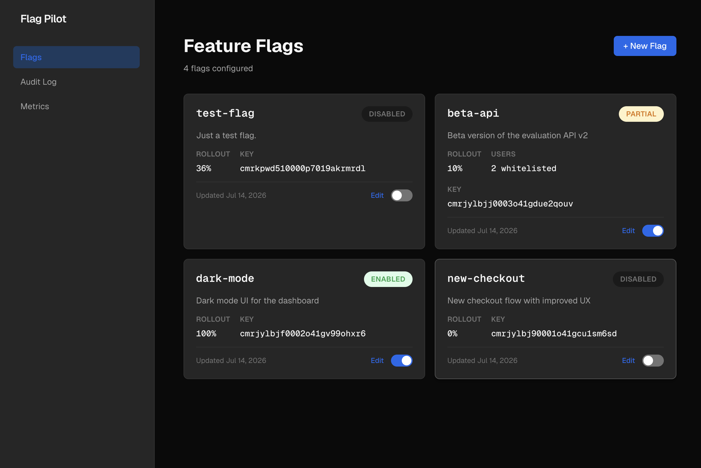

<p align="center">
  
</p>

<h1 align="center">Flag Pilot</h1>

<p align="center">
  <b>Feature flag management system with a dashboard and a REST API.</b>
</p>

<p align="center">
  <a href="https://flag-pilot-dashboard.vercel.app">Demo</a> · 
  <a href="https://github.com/juancaricodev/flag-pilot">Repository</a> · 
  <a href="docs/deployment.md">Deployment Guide</a>
</p>

<hr>

<p align="center">
  <a href="https://github.com/juancaricodev/flag-pilot/blob/main/LICENSE">
    
  </a>
  <a href="https://github.com/juancaricodev/flag-pilot/stargazers">
    
  </a>
  <a href="https://github.com/juancaricodev/flag-pilot/network/members">
    
  </a>
  <a href="https://github.com/juancaricodev/flag-pilot/issues">
    
  </a>
</p>

<hr>

## Overview

**Flag Pilot** is an open-source feature flag management system built with modern web technologies. It provides a dashboard UI and a REST API for creating, targeting, and evaluating feature flags.

### Key Features

- **Real-time flag evaluation** — `POST /api/evaluate` for a plain on/off check, `POST /api/evaluate/context` for per-user decisions
- **Sticky percentage rollout** — Consistent bucketing per `userId` via hash, so a user never flip-flops between requests
- **Targeting rules** — Per-flag whitelist overrides on top of the percentage rollout
- **Redis cache-aside** — 30s TTL on evaluation reads with eager invalidation on mutations; degrades to the database if Redis is unavailable
- **Audit trail** — Every mutation logged with the fields that changed
- **Metrics** — Evaluation counts with an enabled/disabled breakdown
- **Dashboard UI** — Create, edit, toggle, inspect the audit timeline, and read metrics
- **Docker deployment** — API, PostgreSQL, and Redis via Docker Compose

### Roadmap

Not implemented yet — tracked in [`docs/backlog.md`](docs/backlog.md):

- Client SDKs (server-side and browser)
- Multi-environment support (dev / staging / production)
- User roles and permissions
- Webhooks on flag change
- A/B test analytics
- Per-flag metrics endpoint

### Tech Stack

| Component      | Technology                                    |
| -------------- | --------------------------------------------- |
| Dashboard      | Next.js 16, React 19, TypeScript, CSS Modules |
| API            | NestJS 11, Prisma 6, PostgreSQL               |
| Infrastructure | AWS EC2, Docker Compose, GitHub Actions       |
| Testing        | Jest, React Testing Library                   |

## Architecture

Flag Pilot is a **modular monolith**: the API uses **Screaming Architecture** (one folder per domain) and the dashboard uses **Atomic Design**.

```
flag-pilot/
├── apps/
│   ├── dashboard/               # Next.js frontend
│   │   └── src/
│   │       ├── app/             # App Router pages
│   │       ├── components/      # Atomic Design (atoms → molecules → organisms)
│   │       ├── actions/         # Server Actions (all mutations)
│   │       ├── data/            # Data fetchers (Server Components)
│   │       └── proxy.ts         # Auth proxy (Next.js 16 convention)
│   └── api/                     # NestJS backend
│       └── src/
│           ├── flags/           # One folder per domain, each split into
│           ├── auth/            #   presentation/ (controller, DTOs, guards)
│           ├── audit/           #   application/  (services)
│           ├── evaluation/
│           ├── metrics/
│           ├── flag-cache/      # Redis cache-aside wrapper
│           └── prisma/
├── packages/
│   └── shared/                  # Shared TypeScript types
├── openspec/                    # SDD specifications (source of truth)
├── docs/                        # Project documentation
└── skills/                      # Project-specific AI skills
```

### Design Principles

- **Screaming Architecture** — NestJS modules are named after their domain (`flags`, `auth`, `audit`, `evaluation`, `metrics`), so the structure tells you what the system does
- **Atomic Design** — Component hierarchy: atoms → molecules → organisms
- **Server Actions** — All dashboard mutations go through `src/actions/`, never a client-side fetch
- **SDD (Spec-Driven Development)** — Specifications before code
- **TDD** — Test-Driven Development with strict RED → GREEN → REFACTOR

## Quick Start

### Prerequisites

- Node.js 20+
- pnpm
- Docker (PostgreSQL is required; Redis is optional — evaluation degrades to the database without it)

### Installation

```bash
# Clone the repository
git clone https://github.com/juancaricodev/flag-pilot.git
cd flag-pilot

# Install dependencies
pnpm install

# Start PostgreSQL (add Redis separately if you want cache hits)
docker compose up -d
```

### Development

```bash
# Run all apps in development mode
pnpm dev

# Run dashboard only
pnpm --filter dashboard dev

# Run API only
pnpm --filter api start:dev
```

### Testing

```bash
# Run all tests
pnpm test

# Run dashboard tests
pnpm --filter dashboard test

# Run API tests
pnpm --filter api test
```

## Deployment

### Dashboard (Vercel)

Automatically deployed on push to `main`.

- **Production**: [flag-pilot-dashboard.vercel.app](https://flag-pilot-dashboard.vercel.app)

### API (AWS EC2)

Deployed via GitHub Actions with Docker Compose.

```bash
# Production deployment
docker-compose --env-file .env.prod -f docker-compose.prod.yml up -d
```

## API Endpoints

The evaluation endpoints are public. Everything under `/api/flags`, `/api/audit`, and `/api/metrics` requires the auth cookie.

| Method | Endpoint                | Description                                           |
| ------ | ----------------------- | ----------------------------------------------------- |
| GET    | `/health`               | Health check                                          |
| POST   | `/api/auth/login`       | Login — sets an httpOnly JWT cookie (7 days)          |
| POST   | `/api/auth/logout`      | Logout — clears the cookie                            |
| GET    | `/api/flags`            | List all flags                                        |
| POST   | `/api/flags`            | Create a flag                                         |
| GET    | `/api/flags/:id`        | Get a single flag                                     |
| PATCH  | `/api/flags/:id`        | Update a flag (toggle, rollout percentage, whitelist) |
| DELETE | `/api/flags/:id`        | Delete a flag                                         |
| GET    | `/api/flags/:id/audit`  | Audit entries for one flag                            |
| GET    | `/api/audit`            | All audit entries                                     |
| GET    | `/api/metrics`          | Global evaluation metrics                             |
| POST   | `/api/evaluate`         | Evaluate a flag by name                               |
| POST   | `/api/evaluate/context` | Evaluate a flag for a `userId` (whitelist + rollout)  |

## Contributing

We follow a professional development workflow with branch-based development, pull requests, and Spec-Driven Development (SDD).

See [CONTRIBUTING.md](CONTRIBUTING.md) for the full guide.

## License

This project is licensed under the MIT License - see the [LICENSE](LICENSE) file for details.

---

<p align="center">
  Built with ❤️ using Next.js, NestJS, and PostgreSQL
</p>
